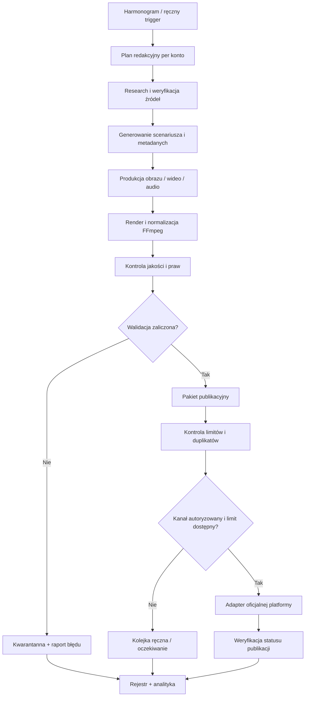

# AUTORED IDEA — architektura systemu

**Wersja:** 0.1 (projekt bazowy)  
**Data audytu:** 2026-11-13  
**Status:** ARCHITECTURE BASELINE — nie jest jeszcze wdrożeniem produkcyjnym

## 1. Cel i zakres

System ma przygotowywać i publikować materiały na:
- TikTok: `@ocenionona6`
- TikTok: `@pieknemedia`
- YouTube: `@MemoryAgent-r3c`

Zakres treści: krótkie filmy, YouTube Shorts, dłuższe filmy YouTube, zdjęcia/posty, tytuły, opisy, hashtagi, tagi, miniatury, oznaczenia treści AI, prawa do mediów, harmonogram i raport wyników.

Każdy profil ma osobną strategię redakcyjną, limity, ustawienia publikacji i historię identyfikatorów publikacji. Materiał nie może być przypadkowo skopiowany na inne konto.

## 2. Zasady projektowe

1. Zero kosztów obowiązkowych: bez płatnych API, subskrypcji, kart i ukrytych opłat. Darmowe limity muszą być rzeczywiście dostępne; nie wolno obchodzić limitów.
2. Brak nieoficjalnych API, scrapingu wymagającego logowania ani automatyzacji omijającej zasady platform.
3. Oddzielenie generowania, kontroli jakości, planowania i publikacji.
4. Idempotencja: ponowienie zadania nie może utworzyć drugiej publikacji.
5. Każda publikacja ma status i identyfikator po stronie platformy.
6. Materiały są przechowywane tylko tak długo, jak jest to potrzebne do produkcji i zgodne z polityką użytkownika. Nie uruchamiać Cloudflare R2 ani trwałego archiwum bez osobnej decyzji.
7. Automatyczna publikacja pozostaje wyłączona w konfiguracji bazowej do chwili potwierdzenia autoryzacji kont, uprawnień aplikacji, testów i polityki publikacji.
8. Działające moduły są rozszerzane małymi zmianami; każda zmiana ma test regresyjny.

## 3. Proponowany przepływ danych

## 4. Moduły

| Moduł | Odpowiedzialność | Kryterium gotowości |
|---|---|---|
| Scheduler | Uruchamianie zadań i retry z backoff | brak utraconych uruchomień, idempotencja |
| Editorial Planner | Tematy i formaty per konto | brak duplikatów tematów, zgodność z profilem |
| Research & Fact Check | Źródła, daty, potwierdzenie twierdzeń | każda teza faktograficzna ma źródło |
| Content Generator | Skrypt, hook, CTA, tytuł, opis, hashtagi | walidacja długości i kompletności |
| Media Renderer | Obraz/wideo/audio, napisy, miniatura | kodeki, rozdzielczość, proporcje, plik odtwarzalny |
| Compliance Gate | Prawa, AI disclosure, safety review, muzyka, prywatność | brak publikacji przy niezaliczonej kontroli |
| Publisher Adapters | Publora/Metricool/API oficjalne | autoryzacja, status końcowy, brak duplikatu |
| Observability | Logi, alerty, statystyki, błędy | możliwa diagnoza każdego przebiegu |
| Recovery | Retry bez duplikatów, dead-letter queue, rollback | test odtworzenia i odzyskania stanu |
| Documentation | Dziennik zmian i decyzji | każda zmiana ma wpis i dowód |

## 5. Wybrany stos techniczny

### Backend i harmonogram — Cloudflare Workers Free

Wybrano Cloudflare Worker jako główny backend, ponieważ konto Cloudflare jest już dostępne, a darmowe limity są wystarczające dla lekkiej orkiestracji i metadanych:
- **Worker:** `autored-idea-api` — wdrożony; obsługuje endpoint health i zdarzenie scheduled.
- **Cron:** `0 7,8 * * *` UTC; kod wykonuje pracę wyłącznie o 09:00 Europe/Warsaw, z kontrolą zmiany czasu letniego/zimowego.
- **D1:** `autored_idea_db`, jurysdykcja EU, region EEUR; tabele profili, treści, zadań publikacji, limitów, uruchomień i zdarzeń.
- **Workers AI:** `@cf/meta/llama-3.1-8b-instruct`; test API zwrócił poprawny JSON przy `response_format=json_object`.
- **KV i R2:** nieużywane. Nie przechowujemy dużych plików mediów w bazie ani w publicznym repozytorium.

Limity darmowego planu według aktualnej dokumentacji Cloudflare:
- Workers Free: 100 000 żądań dziennie, 10 ms CPU na zwykłe wywołanie, 128 MB pamięci i maksymalnie 5 Cron Triggers na konto.
- D1 Free: 5 mln odczytanych wierszy dziennie, 100 tys. zapisanych wierszy dziennie i 5 GB łącznej przestrzeni.
- Workers AI: 10 000 neuronów dziennie bez opłat; po przekroczeniu limitu na planie Free kolejne wywołania są odrzucane, a nie automatycznie płatne. Model tekstowy wybrano z listy obsługującej JSON Mode.
- Limity mają być mierzone; po osiągnięciu limitu system przechodzi w bezpieczny stan, nie obchodzi ograniczeń.

Źródła limitów:
- https://developers.cloudflare.com/workers/platform/limits/
- https://developers.cloudflare.com/d1/platform/pricing/
- https://developers.cloudflare.com/workers-ai/platform/pricing/
- https://developers.cloudflare.com/workers/configuration/cron-triggers/

### CI i produkcja mediów

- **GitHub Actions:** testy regresyjne, kontrola sekretów, walidacja składni Workera i późniejszy pipeline renderowania.
- **FFmpeg:** planowany renderer uruchamiany na runnerze GitHub Actions; nie uruchamiać FFmpeg w Cloudflare Worker (limity CPU/pamięci).
- Renderowane pliki mają być przekazywane bezpośrednio do legalnego adaptera publikacyjnego; nie archiwizować ich w publicznym repozytorium.
- Generowanie obrazów/wideo wymaga osobnej weryfikacji darmowych limitów i licencji; nie zakładać, że darmowe AI API zapewni pełną produkcję wizualną.

### Integracje publikacyjne

- TikTok: obecnie istniejący provider Publora dla `@pieknemedia` oraz Metricool dla `@ocenionona6`; limity planów muszą być odczytywane przed planowaniem. Direct Post API jest alternatywą wyłącznie po oficjalnej autoryzacji i wymaganym zatwierdzeniu aplikacji.
- YouTube: obecne połączenie kanału w Metricool; mapowanie identyfikatora do `@MemoryAgent-r3c` wymaga potwierdzenia. Alternatywa: YouTube Data API/OAuth, po uzyskaniu uprawnień.
- Cloudflare Worker nie ma jeszcze poświadczeń Publora, Metricool, TikTok ani YouTube. Nie ma adapterów publikacji; nie wykonuje publicznych postów.
- Activepieces: istniejący projekt ma tabele, ale 0 aktywnych flow i 0 połączeń. Pozostaje narzędziem pomocniczym/administracyjnym, nie głównym orkiestratorem produkcyjnym. Nie uruchamiać równolegle n8n i Activepieces dla tego samego procesu.

## 5A. Zweryfikowane ograniczenia integracji publikacyjnych (2026-11-13)

### TikTok — oficjalny Content Posting API
- Wymagane są aplikacja developerska, produkt Content Posting API, zatwierdzony scope `video.publish` oraz autoryzacja właściciela każdego konta.
- Przed publikacją aplikacja musi pobrać creator info i respektować opcje prywatności zwrócone dla konta.
- Nieaudytowana aplikacja może publikować wyłącznie materiały prywatne; publikacja publiczna wymaga audytu aplikacji TikTok.
- Token użytkownika ma limit 6 wywołań inicjujących publikację na minutę; upload URL jest ważny 1 godzinę.
- Nie wolno omijać wymagań aplikacji, scope ani audytu. Jeśli audyt nie zostanie przyznany, Direct Post pozostaje trybem prywatnym/testowym.
- TikTok wymaga, aby treści udostępniane przez integracje nie zawierały niechcianych znaków wodnych, logo ani promocyjnych nakładek.

Źródła: https://developers.tiktok.com/docs/en/content-posting-api-get-started ; https://developers.tiktok.com/docs/en/content-posting-api-reference-direct-post ; https://developers.tiktok.com/docs/en/content-sharing-guidelines

### YouTube — Data API
- Upload przez `videos.insert` wymaga OAuth z zakresem `youtube.upload` lub szerszym, odpowiednim zakresem.
- Domyślny limit API obejmuje 100 wywołań `videos.insert` dziennie w osobnym bucket; quota resetuje się o północy czasu Pacific.
- Wymagane jest potwierdzenie, że OAuth i channel ID wskazują dokładnie kanał `@MemoryAgent-r3c`. Obecne mapowanie Metricool nie przechodzi tej kontroli.
- Nie używać kanału o innym ID ani nie wykonywać uploadu testowego na cudzym koncie.

Źródła: https://developers.google.com/youtube/data/reference/rest/v3/videos/insert ; https://developers.google.com/youtube/data/determine_quota_cost

### Publora — darmowy plan i API
- Dokumentacja Publora potwierdza darmowy Starter z limitem 15 publikacji miesięcznie, 3 podłączonymi kontami, maksymalnie 3 zaplanowanymi postami naraz i horyzontem do 7 dni.
- API wymaga klucza `x-publora-key`; użytkownik musi utworzyć klucz ręcznie. Nie wolno wpisywać go do repozytorium, logów ani kodu klienta.
- Publora obsługuje idempotency key, lecz retencja deduplikacji jest ograniczona czasowo; AUTORED IDEA nadal musi prowadzić własny rejestr identyfikatorów i weryfikować status po timeout.
- Obecne konto ma aktywne połączenie TikTok `@pieknemedia`. Workspace/Agency nie jest skonfigurowany.
- Limit 15 publikacji miesięcznie jest niewystarczający dla codziennej publikacji na wszystkich trzech profilach. Nie zakładać większej przepustowości bez potwierdzonego darmowego limitu innego dostawcy.

Źródła: https://docs.publora.com/getting-started ; https://docs.publora.com/endpoints/create-post ; https://docs.publora.com/guides/scheduling

## 6. Model danych

Minimalne encje:
- `accounts`: platforma, uchwyt, connection_id, status autoryzacji, limity, strefa czasowa.
- `content_items`: konto, temat, format, skrypt, metadane, język, źródła, status.
- `media_assets`: ścieżka/URL, MIME, rozmiar bajtów, hash SHA-256, wymiary, czas trwania, licencja, status.
- `publication_jobs`: planowany czas, adapter, idempotency_key, próby, status.
- `publications`: platform_post_id, URL, data publikacji, wynik.
- `events`: log zdarzeń bez sekretów.
- `quota_ledger`: limit, zużycie, data resetu, źródło odczytu.
- `approvals`: decyzja i czas zatwierdzenia, jeśli tryb zatwierdzania jest włączony.

Obecne tabele Activepieces (Kalendarz treści, Biblioteka mediów, Dziennik automatyzacji, Integracje i konfiguracja) są punktem wyjścia, ale przed produkcją wymagają kontroli pól, retencji i testów spójności.

## 7. Reguły publikacji per profil

- `@pieknemedia`: odrębny styl i kalendarz; obecne połączenie Publora.
- `@ocenionona6`: treści bardziej merytoryczne; obecne połączenie TikTok w Metricool.
- `@MemoryAgent-r3c`: kanał YouTube; treści i metadane w modelu YouTube, nie kopiować automatycznie opisów TikTok.
- Strefa czasu harmonogramu: Europe/Warsaw.
- Każdy kanał ma osobny dzienny/tygodniowy limit i licznik platformowy.
- Muzyka: tylko katalog i licencje dopuszczone przez platformę; nie osadzać muzyki bez praw.
- Safety review: każdy pakiet ma status pending/passed/blocked; publikacja jest zablokowana do statusu passed.
- AI disclosure: ustawiać zgodnie z wymaganiami platformy i rodzajem treści.
- Muzyka TikTok: dla postów zdjęciowych używać wyłącznie dozwolonego mechanizmu wyboru muzyki przez Publora (autoAddMusic=true, jeśli jest dostępny dla danego konta); dla filmów muzykę osadzać przed uploadem tylko wtedy, gdy istnieje potwierdzona licencja na użycie komercyjne i publikację na danej platformie. Nie pobierać ani nie osadzać utworów bez praw.

## 8. Warunki uruchomienia produkcyjnego

Nie uruchamiać automatycznej publikacji, dopóki wszystkie punkty nie są VERIFIED:
- autoryzacja właściwego konta i wymagane scope;
- potwierdzona ścieżka publikacji oficjalna lub zatwierdzony dostawca;
- test publikacji w trybie prywatnym/testowym i odczyt statusu;
- kontrola duplikatów i idempotencji;
- walidacja plików (format, wymiary, rozmiar, długość, kodek);
- AI disclosure, prawa muzyczne i prawa do obrazu;
- testy awarii, retry i odtworzenia;
- zgodność z limitami darmowego planu.

## 9. Źródła techniczne

- TikTok Content Posting API — start: https://developers.tiktok.com/docs/en/content-posting-api-get-started
- TikTok Direct Post: https://developers.tiktok.com/docs/en/content-posting-api-reference-direct-post
- TikTok Content Sharing Guidelines: https://developers.tiktok.com/docs/en/content-sharing-guidelines
- YouTube Data API — upload: https://developers.google.com/youtube/data/guides/uploading_a_video
- YouTube videos.insert: https://developers.google.com/youtube/data/reference/rest/v3/videos/insert
- YouTube OAuth: https://developers.google.com/youtube/documentation/authentication
- Activepieces Cloud pricing: https://www.activepieces.com/pricing
- Activepieces self-hosting: https://www.activepieces.com/docs/install/options/docker-compose
- FFmpeg: https://ffmpeg.org/documentation.html

Źródła należy sprawdzić ponownie przed implementacją, ponieważ limity i wymagania platform zmieniają się.
