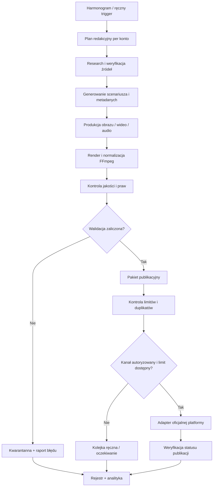

# AUTORED IDEA — architektura systemu

**Wersja:** 0.1 (projekt bazowy)  
**Data audytu:** 2026-11-13  
**Status:** ARCHITECTURE BASELINE — nie jest jeszcze wdrożeniem produkcyjnym

## 1. Cel i zakres

System ma przygotowywać i publikować materiały na:
- TikTok: `@ocenionona6`
- TikTok: `@pieknemedia`
- YouTube: `@MemoryAgent-r3`

Zakres treści: krótkie filmy, YouTube Shorts, dłuższe filmy YouTube, zdjęcia/posty, tytuły, opisy, hashtagi, tagi, miniatury, oznaczenia treści AI, prawa do mediów, harmonogram i raport wyników.

Każdy profil ma osobną strategię redakcyjną, limity, ustawienia publikacji i historię identyfikatorów publikacji. Materiał nie może być przypadkowo skopiowany na inne konto.

## 2. Zasady projektowe

1. Zero kosztów obowiązkowych: bez płatnych API, subskrypcji, kart i ukrytych opłat. Darmowe limity muszą być rzeczywiście dostępne; nie wolno obchodzić limitów.
2. Brak nieoficjalnych API, scrapingu wymagającego logowania ani automatyzacji omijającej zasady platform.
3. Oddzielenie generowania, kontroli jakości, planowania i publikacji.
4. Idempotencja: ponowienie zadania nie może utworzyć drugiej publikacji.
5. Każda publikacja ma status i identyfikator po stronie platformy.
6. Materiały są przechowywane tylko tak długo, jak jest to potrzebne do produkcji i zgodne z polityką użytkownika. Nie uruchamiać Cloudflare R2 ani trwałego archiwum bez osobnej decyzji.
7. Automatyczna publikacja pozostaje wyłączona w konfiguracji bazowej do chwili potwierdzenia autoryzacji kont, uprawnień aplikacji, testów i polityki publikacji.
8. Działające moduły są rozszerzane małymi zmianami; każda zmiana ma test regresyjny.

## 3. Proponowany przepływ danych

## 4. Moduły

| Moduł | Odpowiedzialność | Kryterium gotowości |
|---|---|---|
| Scheduler | Uruchamianie zadań i retry z backoff | brak utraconych uruchomień, idempotencja |
| Editorial Planner | Tematy i formaty per konto | brak duplikatów tematów, zgodność z profilem |
| Research & Fact Check | Źródła, daty, potwierdzenie twierdzeń | każda teza faktograficzna ma źródło |
| Content Generator | Skrypt, hook, CTA, tytuł, opis, hashtagi | walidacja długości i kompletności |
| Media Renderer | Obraz/wideo/audio, napisy, miniatura | kodeki, rozdzielczość, proporcje, plik odtwarzalny |
| Compliance Gate | Prawa, AI disclosure, muzyka, prywatność | brak publikacji przy niezaliczonej kontroli |
| Publisher Adapters | Publora/Metricool/API oficjalne | autoryzacja, status końcowy, brak duplikatu |
| Observability | Logi, alerty, statystyki, błędy | możliwa diagnoza każdego przebiegu |
| Recovery | Retry bez duplikatów, dead-letter queue, rollback | test odtworzenia i odzyskania stanu |
| Documentation | Dziennik zmian i decyzji | każda zmiana ma wpis i dowód |

## 5. Wstępny dobór technologii

### Orkiestracja
- **Activepieces**: istniejący projekt i tabele mogą pozostać warstwą operacyjną. Obecnie projekt nie ma przepływów ani połączeń. Darmowy plan Cloud ma limit kredytów; self-hosting wymaga stale działającej infrastruktury.
- **GitHub Actions**: CI, testy, walidacja dokumentacji i kontrolowane zadania pomocnicze. Nie traktować harmonogramu Actions jako gwarantowanego zegara publikacji.
- Nie wdrażać równolegle n8n i Activepieces. Jeden orkiestrator na produkcję ogranicza złożoność.

### Produkcja mediów
- **FFmpeg**: renderowanie, konwersja, normalizacja audio/wideo, napisy i miniatury.
- Generowanie AI: najpierw wykryć dostępny bezpłatny sposób i mierzalne limity. Nie wpisywać płatnego API jako wymaganego komponentu. Model lokalny wymaga sprzętu i nie jest „bezpłatny” w sensie kosztu energii/sprzętu.
- Każdy zasób ma jawne źródło i status licencji.

### Publikacja
- TikTok: oficjalny Content Posting API po zatwierdzeniu aplikacji i scope `video.publish`; przed audytem treści są ograniczone do prywatnych.
- YouTube: YouTube Data API `videos.insert` z OAuth 2.0 użytkownika i scope upload; trzeba zweryfikować limity i status projektu Google Cloud.
- Publora/Metricool: używać tylko w ramach realnych planów, kont i limitów. Nie zakładać, że ich darmowe limity wystarczą na docelową liczbę publikacji.

## 6. Model danych

Minimalne encje:
- `accounts`: platforma, uchwyt, connection_id, status autoryzacji, limity, strefa czasowa.
- `content_items`: konto, temat, format, skrypt, metadane, język, źródła, status.
- `media_assets`: ścieżka/URL, MIME, rozmiar bajtów, hash SHA-256, wymiary, czas trwania, licencja, status.
- `publication_jobs`: planowany czas, adapter, idempotency_key, próby, status.
- `publications`: platform_post_id, URL, data publikacji, wynik.
- `events`: log zdarzeń bez sekretów.
- `quota_ledger`: limit, zużycie, data resetu, źródło odczytu.
- `approvals`: decyzja i czas zatwierdzenia, jeśli tryb zatwierdzania jest włączony.

Obecne tabele Activepieces (Kalendarz treści, Biblioteka mediów, Dziennik automatyzacji, Integracje i konfiguracja) są punktem wyjścia, ale przed produkcją wymagają kontroli pól, retencji i testów spójności.

## 7. Reguły publikacji per profil

- `@pieknemedia`: odrębny styl i kalendarz; obecne połączenie Publora.
- `@ocenionona6`: treści bardziej merytoryczne; obecne połączenie TikTok w Metricool.
- `@MemoryAgent-r3`: kanał YouTube; treści i metadane w modelu YouTube, nie kopiować automatycznie opisów TikTok.
- Strefa czasu harmonogramu: Europe/Warsaw.
- Każdy kanał ma osobny dzienny/tygodniowy limit i licznik platformowy.
- Muzyka: tylko katalog i licencje dopuszczone przez platformę; nie osadzać muzyki bez praw.
- AI disclosure: ustawiać zgodnie z wymaganiami platformy i rodzajem treści.

## 8. Warunki uruchomienia produkcyjnego

Nie uruchamiać automatycznej publikacji, dopóki wszystkie punkty nie są VERIFIED:
- autoryzacja właściwego konta i wymagane scope;
- potwierdzona ścieżka publikacji oficjalna lub zatwierdzony dostawca;
- test publikacji w trybie prywatnym/testowym i odczyt statusu;
- kontrola duplikatów i idempotencji;
- walidacja plików (format, wymiary, rozmiar, długość, kodek);
- AI disclosure, prawa muzyczne i prawa do obrazu;
- testy awarii, retry i odtworzenia;
- zgodność z limitami darmowego planu.

## 9. Źródła techniczne

- TikTok Content Posting API — start: https://developers.tiktok.com/docs/en/content-posting-api-get-started
- TikTok Direct Post: https://developers.tiktok.com/docs/en/content-posting-api-reference-direct-post
- TikTok Content Sharing Guidelines: https://developers.tiktok.com/docs/en/content-sharing-guidelines
- YouTube Data API — upload: https://developers.google.com/youtube/data/guides/uploading_a_video
- YouTube videos.insert: https://developers.google.com/youtube/data/reference/rest/v3/videos/insert
- YouTube OAuth: https://developers.google.com/youtube/documentation/authentication
- Activepieces Cloud pricing: https://www.activepieces.com/pricing
- Activepieces self-hosting: https://www.activepieces.com/docs/install/options/docker-compose
- FFmpeg: https://ffmpeg.org/documentation.html

Źródła należy sprawdzić ponownie przed implementacją, ponieważ limity i wymagania platform zmieniają się.
